# Manual de usuario — Rutas L&H

Sistema para planificar, asignar y seguir las rutas de distribución de L&H Distribuciones. Tiene dos
experiencias: el **panel** (administrador y coordinador, en computador) y la **app del conductor** (en el celular).

Las imágenes se generan con datos de demostración (`docs/manual/capturas.spec.ts`); los nombres son ficticios.

## 1. Quién puede hacer qué

| Rol | Qué puede hacer |
|---|---|
| **Coordinador** | Planificar y asignar rutas, administrar zonas, productos y destinos, ver reportes. |
| **Administrador** | Todo lo del coordinador y además vehículos, conductores, usuarios y la bitácora. |
| **Conductor** | Usa solo la app: acepta o rechaza rutas, las inicia, confirma entregas y reporta novedades. |

## 2. Ingresar

1. Abra la dirección del sistema en el navegador (Chrome, Firefox, Edge o Safari).
2. Escriba su correo y contraseña y pulse **Iniciar Sesión**.
3. Si es su primer ingreso o le restablecieron la contraseña, el sistema le pide crear una nueva antes de seguir.
4. Para salir: menú con su nombre (arriba a la derecha) → **Cerrar sesión**.

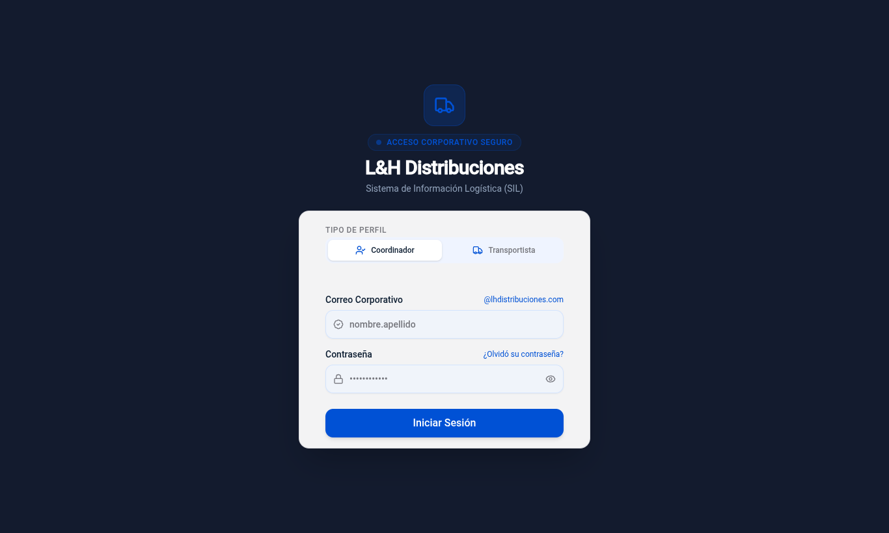

- Después de 10 intentos fallidos desde un mismo equipo hay que esperar 15 minutos.
- Si olvidó la contraseña, pídale al administrador que la restablezca; el sistema le dará una temporal.

## 3. Inicio del panel

Resume el día: rutas pendientes de planificar, rutas en curso, entregas del día (realizadas / total) y
conductores listos. Debajo aparecen las **asignaciones sin responder**: rutas que llevan más de 30 minutos
sin que el conductor las acepte o rechace. Esas son las que debe llamar o reasignar.

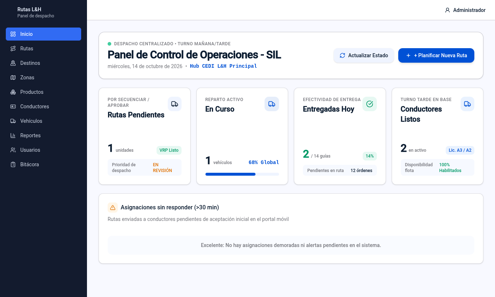

## 4. Preparar los datos base

Se hace una vez y se mantiene al día. Menú lateral:

| Sección | Qué registrar |
|---|---|
| **Zonas** | Sectores de reparto (Norte, Centro, Sur…). |
| **Productos** | Código, descripción, unidad de medida y peso por unidad (el peso permite calcular la carga). |
| **Vehículos** (administrador) | Placa, tipo y capacidad de carga en kg. |
| **Conductores** (administrador) | Nombre, documento, licencia, teléfono y vehículo habitual. Al crearlo se genera su usuario y una **contraseña temporal que se muestra una sola vez**: anótela y entréguela al conductor. |
| **Destinos** | Clientes a los que se entrega: nombre, dirección, zona, horario de atención y ubicación en el mapa. |

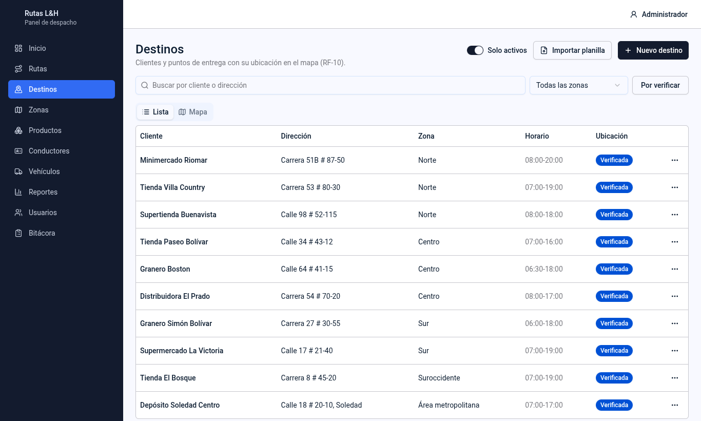

### Ubicación de un destino (obligatoria)

Las direcciones de Barranquilla ("Calle 72 # 45-23") se encuentran mal en los buscadores. Por eso, al crear un
destino **debe confirmar su ubicación en el mapa**: pulse sobre el punto correcto o arrastre el marcador. Sin
"Ubicación confirmada" no se guarda. En la pestaña **Mapa** de Destinos ve todos los clientes a la vez.

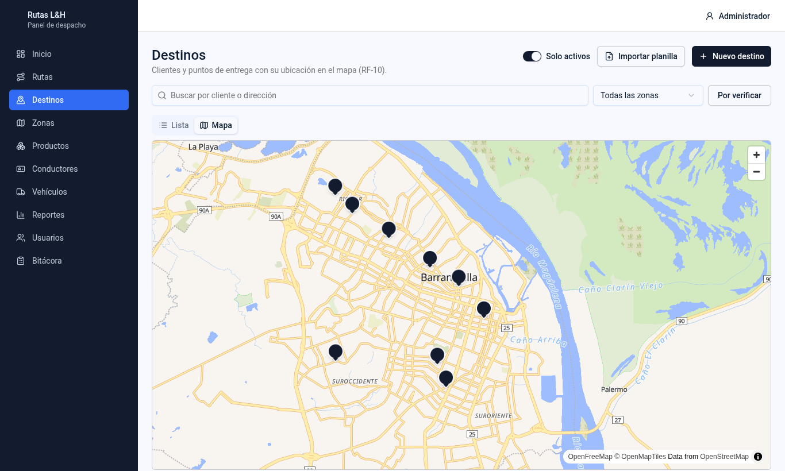

### Importar destinos desde una planilla

En Destinos → **Importar planilla**: suba un archivo CSV con las columnas `cliente`, `direccion` y `zona`
(obligatorias) y, opcionalmente, `horario`, `telefono`, `latitud` y `longitud`. Hasta 100 filas por archivo.
Las filas sin coordenadas se buscan automáticamente (una por segundo) y quedan marcadas **por verificar**
hasta que confirme su ubicación.

## 5. Planificar una ruta

Menú **Rutas**. La lista muestra código, fecha, estado, número de paradas, carga, vehículo, conductor y distancia;
puede filtrar por estado, fechas o buscar por código.

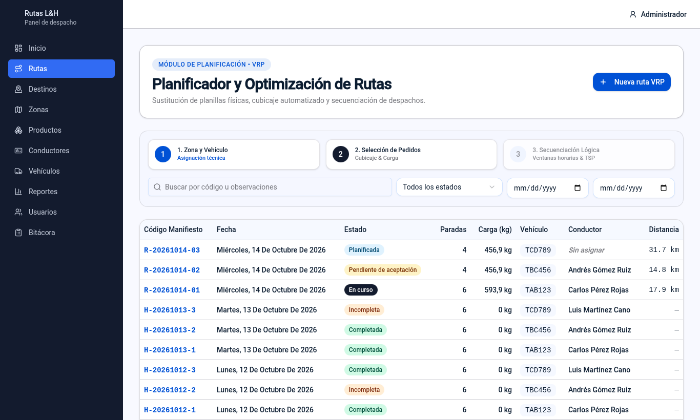

1. Pulse **Nueva ruta VRP** y elija la fecha y el vehículo.
2. **Agregue paradas** con *Agregar parada (buscar destino)*; para cada una indique los productos y cantidades. Puede reordenarlas
   arrastrando cada parada. Un destino no puede repetirse en la misma ruta.
3. Vigile la barra de **Carga**: no puede superar la capacidad del vehículo (el sistema no deja guardar si se pasa).
4. Pulse **Guardar cambios**. Mientras no guarde verá el aviso "Cambios sin guardar"; si cierra por error, el borrador se
   conserva en su navegador.
5. **Calcular recorrido** dibuja la línea por las calles en el orden actual y muestra distancia y tiempo estimado
   de llegada a cada parada. **Optimizar orden** busca el mejor orden respetando los horarios de atención y la capacidad.
6. Cuando la ruta está lista pulse **Marcar como planificada**. Una ruta planificada ya no se edita; si necesita cambiarla use
   **Volver a borrador**.

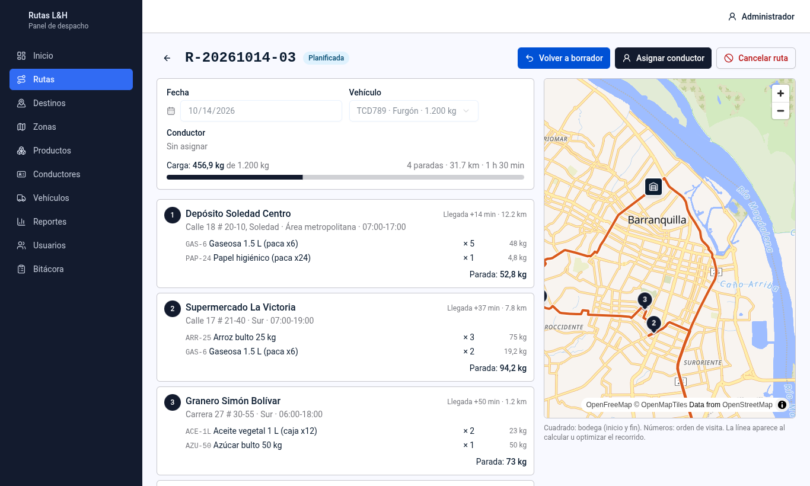

En el mapa, el edificio es la bodega (inicio y fin), los números son el orden de visita y la línea es el recorrido.

> Si el cálculo o la optimización fallan con un mensaje sobre el servicio de rutas, avise al administrador (ver
> `docs/runbook.md`). Mientras tanto puede seguir armando y guardando rutas en borrador.

## 6. Asignar la ruta a un conductor

1. Abra una ruta **Planificada** → **Asignar conductor**.
2. Elija el conductor. El sistema no deja asignarlo si ya tiene otra ruta activa ese día o no está disponible.
3. La ruta pasa a **Pendiente de aceptación** y el conductor recibe un aviso en su app.
4. El conductor la **acepta** (queda **Asignada**) o la **rechaza** indicando el motivo; si la rechaza, la ruta
   vuelve a **Planificada** y el motivo queda visible para que la asigne a otro.
5. Para cambiar de conductor use **Reasignar conductor**; el anterior queda liberado y notificado.
6. **Cancelar ruta** la anula (también libera al conductor).

### Estados de una ruta

| Estado | Significa |
|---|---|
| Borrador | Se está armando; se puede editar. |
| Planificada | Lista, con recorrido calculado; falta asignarla. |
| Pendiente de aceptación | Asignada; espera la respuesta del conductor. |
| Asignada | El conductor la aceptó; aún no sale. |
| En curso | El conductor inició la ruta. |
| Completada | Todas las paradas se resolvieron y el conductor finalizó. |
| Incompleta | Se finalizó con paradas no entregadas. |
| Cancelada | Anulada por el despacho. |

El detalle de cada ruta incluye el **historial de estados** (quién hizo cada cambio y cuándo).

## 7. Seguimiento, reportes y bitácora

- **Seguimiento del día:** en Inicio y en la lista de Rutas (filtrando por estado) ve qué rutas están en curso y
  cuántas entregas van. El detalle de una ruta muestra el estado de cada parada y las novedades.
- **Reportes:** elija el periodo y la pestaña **Rutas** (por estado y entregas realizadas / pendientes /
  fallidas), **Conductores** (rutas, entregas, novedades y tiempo promedio de aceptación) o **Zonas**.
  **Exportar Excel** y **Exportar PDF** descargan lo que está en pantalla.

  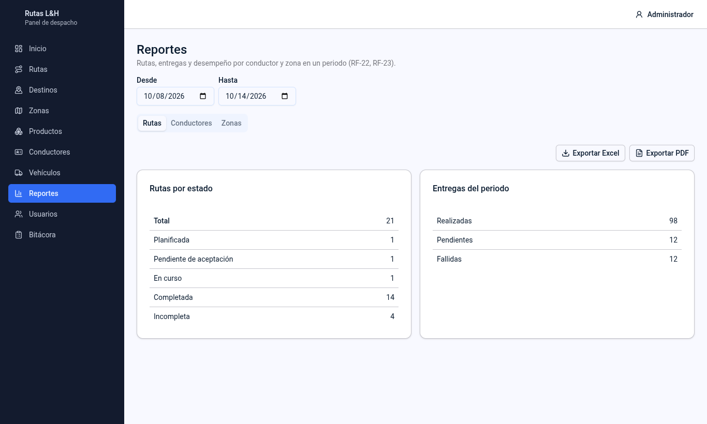

- **Bitácora** (administrador): registro de quién hizo qué y cuándo; se filtra por acción, entidad, usuario y
  fechas, y se exporta a Excel.

  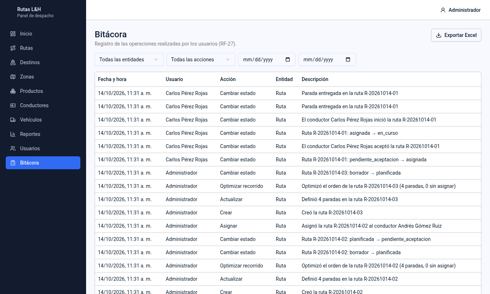

## 8. Usuarios (administrador)

**Usuarios** → **Nuevo usuario**: nombre, correo y rol. El sistema genera una contraseña temporal que se muestra
una sola vez. Desde la lista puede restablecer una contraseña o desactivar a una persona (no se borra, para
conservar su historial).

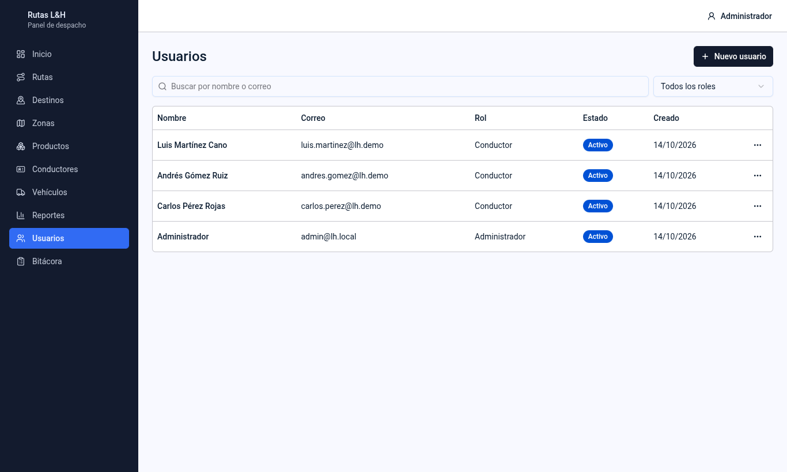

## 9. App del conductor

Se abre en el navegador del celular con la misma dirección del sistema (puede agregarla a la pantalla de inicio
desde el menú del navegador). Barra inferior: **Inicio**, **Mi ruta**, **Cuenta**.

1. **Inicio:** si tiene una ruta pendiente de aceptación, pulse **Aceptar** o **Rechazar** (con motivo).

   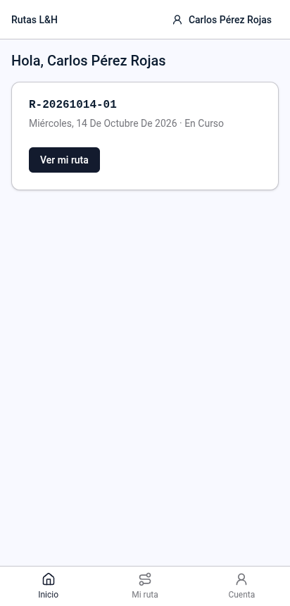

2. **Mi ruta:** muestra el mapa con el recorrido, la siguiente parada resaltada y la lista de paradas con sus
   productos. Pulse **Iniciar ruta** al salir.
3. En cada parada: **Entregado** al completarla, o **Novedad** si no pudo (cliente ausente, rechazo de mercancía,
   dirección incorrecta, devolución parcial u otro, con una nota opcional). Para ir hasta la parada hay enlaces
   que abren **Waze** o **Google Maps**.
4. Cuando todas las paradas estén resueltas pulse **Finalizar ruta**. Si hubo novedades queda como *Incompleta*.

   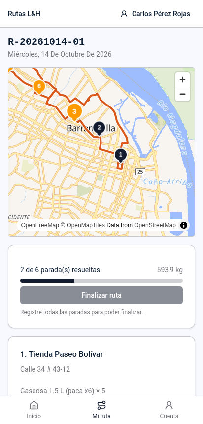

La app necesita conexión a internet; si se pierde, espere a recuperarla antes de confirmar la parada.

## 10. Preguntas frecuentes

**No encuentro un destino al armar la ruta.** Revise que esté activo y creado en la zona correcta (sección 4).

**El sistema no me deja guardar la ruta.** Casi siempre es la capacidad del vehículo: quite carga o elija un
vehículo más grande. También avisa si repite un destino.

**El conductor no ve su ruta.** Confirme que la ruta esté en *Pendiente de aceptación* o *Asignada* para ese
conductor y que él haya ingresado con su propio usuario.

**Me equivoqué al marcar una entrega.** Avise al coordinador: el historial conserva cada cambio y el
administrador puede revisarlo en la bitácora.

**Cambié de computador y perdí un borrador.** Los borradores sin guardar viven en el navegador donde se escribieron;
guarde la ruta antes de cambiar de equipo.
